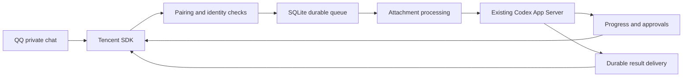

# Architecture

`src/channels/qq` owns the platform transport. `src/agents/codex` adapts the existing local agent. `src/services/runner.ts` coordinates tasks without mixing message delivery with agent execution. `src/storage` owns SQLite transactions and event uniqueness. `src/media` bounds downloads, staging, processing, and optional speech providers.

The primary backend uses the already-running Codex Unix control socket. It initializes JSON-RPC, resumes the same thread without permission overrides, receives agent-message deltas, and tracks turns. It waits while a desktop turn is active. The explicit `queue` backend is a compatibility fallback with final-result polling; it cannot provide reliable remote cancellation or approval handling.

A bot-account/message-ID unique constraint suppresses duplicate task admission. Execution and delivery have separate states. Restarting after an ambiguous submission does not blindly submit again. An ambiguous send does not blindly upload again. These choices do not provide global exactly-once semantics across QQ and Codex.

Approval decisions are bound to a real request, connection, task, turn, account, user, nonce, and expiry. The tool only offers one-time acceptance or refusal. Existing client policy and server routing still apply.
